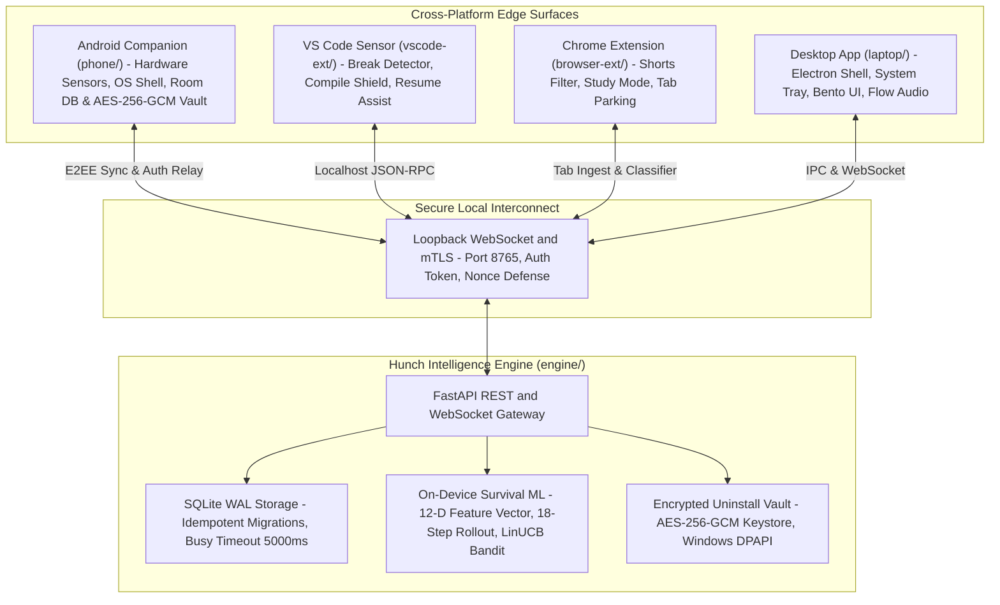

# Hunch: Attention Digital Twin

<div align="center">


### Knows what that notification will cost you — before it disrupts your flow.

[](https://github.com/abhigyan24-ops/hunch-attention-twin/releases/latest)
[](phone/)
[](docs/PRIVACY.md)
[](https://github.com/abhigyan24-ops/hunch-attention-twin/actions/workflows/release.yml)
[](LICENSE)

</div>

---

**Hunch** is an authentic, on-device digital twin of your human attention. It models your individual focus rhythms, quantifies the cognitive switching penalties of incoming notifications, and acts as a cross-device flow shield between your computer and mobile phone.

Operating with zero cloud dependencies, zero telemetry, and zero user accounts, Hunch pairs an **Online Logistic Hazard Survival Model** with an **Adaptive 4-Arm Diagonal LinUCB Contextual Bandit** running directly on edge hardware.

---

## Download Hunch v2.0.0

All release binaries are cryptographically signed, reproducible, and available on the [Latest Release Page](https://github.com/abhigyan24-ops/hunch-attention-twin/releases/latest).

| Surface | Distribution Asset | Target Platform | Description |
| :--- | :--- | :--- | :--- |
| **Android Companion** | [`Hunch-2.0.0.apk`](https://github.com/abhigyan24-ops/hunch-attention-twin/releases/latest) | Android 10+ (API 29–35) | Full Android Companion app with hardware sensor fusion, Quick Settings tile, and AES-256 vault. |
| **Windows Desktop** | [`Hunch-Setup-2.0.0.exe`](https://github.com/abhigyan24-ops/hunch-attention-twin/releases/latest) | Windows 10 / 11 (x64) | Bundled Desktop Companion including Python Twin Engine, Electron Tray UI, and Bento Dashboard. |
| **VS Code Extension** | [`dhyan.vsix`](https://github.com/abhigyan24-ops/hunch-attention-twin/releases/latest) | VS Code 1.93.0+ | Telemetry sensor, Build Shield, Cognitive Thrash Shield, and 10-Second Mental Replay companion. |
| **Browser Extension** | [`hunch-browser-ext-2.0.0.zip`](https://github.com/abhigyan24-ops/hunch-attention-twin/releases/latest) | Chrome, Brave, Edge | Dual-Use Study Mode sensor, surgical YouTube Shorts filter, and timestamped tab parking. |

> All release assets include SHA-256 checksums published in `SHA256SUMS.txt`. Existing `v1.0.0` Android users can install `Hunch-2.0.0.apk` directly over their current installation without losing local database records or pairing keys (`versionCode = 2`).

---

## System Architecture



---

## Core Pillars of Hunch v2.0.0

### 1. On-Device Machine Learning & Contextual Bandit

Hunch eliminates static heuristic timers and rule engines in favor of authentic, on-device machine learning with zero binary dependencies (pure Kotlin and standard Python math):

* **12-Dimensional Normalized Feature Vector ($\mathbf{x}_t \in [0.0, 1.0]^{12}$):** Real-time encoding of circadian rhythm, rolling keystroke cadence, window switch velocity, notification dwell, phone screen state, earbud status, compile lock, thrash score, task switch penalty, idle decay, and break urgency.
* **18-Step Survival Hazard Rollout:** Computes survival curves $P(\text{focus persists} > t)$ over future time horizons $t \in [1..18]$ using an online logistic hazard survival model:
  $$\lambda_t(\mathbf{x}) = \sigma(\mathbf{w}_t^\top \mathbf{x})$$
* **4-Arm Diagonal LinUCB Contextual Bandit:** Actuation actions (`Silent Pass`, `Hold for Digest`, `Subtle Nudge`, `Immediate Intervene`) explore and exploit with an adaptive exploration bonus:
  $$\text{Score}_a = \mathbf{x}^\top \hat{\boldsymbol{\theta}}_a + \alpha \sqrt{\mathbf{x}^\top \mathbf{A}_a^{-1} \mathbf{x}}$$
* **Invisible Math Policy:** Gradient steps, Brier calibration scores, and LinUCB covariance matrices remain strictly internal. User interfaces translate predictions into clear, human-intelligible states ("Deep Work Flow", "Fragile Focus", "Rest Window").

### 2. Dual-Use Study Mode & Surgical Shorts Filter

Traditional screen-time apps fail students and engineers because platforms like YouTube, Reddit, and Chrome are essential for reading documentation, viewing university lectures, and debugging.

* **Web Browsers Are Never Blocked:** Chrome, Firefox, Brave, and Edge are recognized as primary research tools and are never flagged as doomscroll triggers.
* **Cross-Device Code-Along Detection:** Correlates active IDE keystrokes and editor events with video playback on desktop or phone. When code is being typed alongside a technical tutorial, study mode is automatically engaged.
* **Surgical URL & Title Filtering:** Whitelists educational tutorials (`/watch?v=`) while isolating and blocking algorithmic infinite loops (`/shorts/` and Reels). Whitelists technical forums (`/r/programming`, `/r/rust`) while triaging entertainment feeds.
* **Timestamped YouTube Tab Parking:** Non-essential research tabs can be parked with a single click or shortcut, preserving the exact playback timestamp (`t=142s`) and restoring it in the Shared Desk during scheduled breaks.

### 3. Proactive Flow Protection & Sensor Fusion

Hunch senses physical context shifts through multi-sensor hardware fusion:

* **4-Gate Walk-Away Step Detector:** Fuses accelerometer variance, hardware step counters, phone screen off, and laptop keyboard idle to detect physical departure within 4 seconds, holding incoming alerts until return.
* **Flip-to-Focus:** Inverting the phone face-down automatically engages Do Not Disturb and broadcasts a Quiet Lease to the desktop twin.
* **Earbuds-In Trigger:** Detecting wired or Bluetooth audio connection shifts the device twin into deep focus.
* **Build-Time Compile Shield:** Integrates with VS Code build tasks to suppress all non-urgent notifications during compilation and unit test execution.
* **Cognitive Thrash Shield:** Detects rapid branch toggles, high undo-to-edit ratios, and fast file switching, notifying the twin of potential debugging thrash.
* **Fatigue Pre-Commit Sanity Check:** Evaluates late-night cognitive fatigue before git commits, providing a warning before pushing code during low-energy windows.
* **10-Second Mental Replay:** Restores cursor position, recently edited files, and active diffs in VS Code when returning from an interruption.

### 4. Smart Notification Triage

* **In-Memory OTP Regex Bypass:** Two-factor authentication codes and one-time passwords bypass notification holds instantly, parsing purely in memory and syncing directly to the laptop clipboard without logging sensitive verification codes.
* **3-in-3m Repeated-Caller Breakthrough:** Emergency breakthrough permits urgent phone calls if the same contact calls 3 times within a 3-minute window.
* **1-Tap `PendingIntent` Break Digest:** Held notifications are bundled into an interactive summary card. A single tap allows the user to dismiss, open, or consume held alerts once a natural focus milestone is reached.

### 5. Zero-Knowledge Privacy Ledger & Encrypted Vault

* **100% Localhost Operation:** All communications occur over authenticated loopback WebSockets (`localhost:8765`) protected with SHA-256 tokens and monotonic sequence numbering to prevent replay attacks.
* **3-Layer `AES-256-GCM` Uninstall Survival Vault:** Protects pairing credentials, calibration state, and model weights across Android uninstalls and updates via `EncryptedSharedPreferences` backed by the hardware Android Keystore (or Windows DPAPI on desktop).
* **Instant Cryptographic Wipe:** Users can purge all local databases, session keys, and machine learning models with a single command or UI action.

### 6. 4-Tier Progressive Trust Android Onboarding

To provide complete transparency without requiring all system permissions upfront, Hunch uses a 4-tier progressive trust hierarchy:

* **Tier 1 (Base):** Requires zero special permissions. Provides manual focus sessions and local timer management.
* **Tier 2 (Usage & Screen State):** Enables app category tracking and screen on/off sensing via standard Android usage statistics.
* **Tier 3 (Notification Interception):** Enables notification holding and triage via `NotificationListenerService` (metadata only; message bodies are never retained).
* **Tier 4 (Accessibility & OS Flow Control):** Enables surgical URL classification and doomscroll intervention via Android Accessibility.
* **Android 13/14/15 Restricted Settings Unlocker:** Built-in guidance helps users safely authorize sideloaded accessibility permissions via `App Info -> Restricted Settings`.

---

## Repository Directory Structure

```
hunch-attention-twin/
├── .github/
│   └── workflows/
│       ├── release.yml             # Automated CI for Windows, Android, VSIX & Browser
│       └── tests.yml               # Cross-platform matrix test runner
├── browser-ext/                    # Chrome / Brave / Edge Browser Extension
│   ├── manifest.json               # Manifest V3 configuration (v2.0.0)
│   ├── content.js                  # Surgical Shorts filter & Code-Along listener
│   └── domain-classifier.js        # Technical vs entertainment content classifier
├── contracts/                      # Cross-device synchronization contracts
│   └── sync/                       # JSON schemas and test vectors
├── core-spec/                      # Canonical categories, schemas & fixtures
├── docs/                           # Architecture, privacy, and release specifications
│   ├── HUNCH_RELEASE_AND_AUTO_UPDATE_SPEC.md
│   ├── HUNCH_PRODUCTION_AUDIT_REPORT.md
│   └── PRIVACY.md
├── engine/                         # Python Intelligence Engine
│   ├── twin/
│   │   ├── api/app.py              # FastAPI server, REST routes & OTA update checker
│   │   ├── ml_model.py             # Pure-Python Online Survival Model & LinUCB Bandit
│   │   ├── storage.py              # SQLite WAL mode storage engine
│   │   └── security.py             # DPAPI / AES-256 encryption & token validation
│   └── tests/                      # Automated test suite (100% pass)
├── laptop/                         # Windows Desktop Companion (Electron + React)
│   ├── src/
│   │   ├── main/                   # Electron main process & IPC handlers
│   │   └── panel/                  # Bento dashboard, InsightsTab, & Flow Audio
│   └── test/                       # Unit and integration test suite
├── phone/                          # Android Companion App (Kotlin + Jetpack Compose)
│   └── app/
│       ├── src/main/java/com/dhyan/app/
│       │   ├── ml/                 # Kotlin Online Survival Model & Contextual Bandit
│       │   ├── update/             # GitHub Releases OTA Update Checker
│       │   ├── vault/              # 3-Layer AES-256-GCM Encrypted Vault
│       │   └── ui/                 # Jetpack Compose UI & Companion Cards
│       └── src/test/               # Android JVM unit test suite
├── vscode-ext/                     # VS Code Sensor & Attention Companion
│   ├── src/                        # Sensor hooks, break detector, & compile shield
│   └── test/                       # VS Code extension unit test suite
├── CHANGELOG.md                    # Release history and feature notes
├── LICENSE                         # Apache-2.0 License
├── VERSION                         # Master SemVer string (2.0.0)
└── README.md                       # Repository master documentation
```

---

## Quick Start Guide

### 1. Python Intelligence Engine (`engine/`)

```bash
cd engine
python -m venv venv
# Windows:
.\venv\Scripts\activate
# Linux/macOS:
source venv/bin/activate

pip install -r requirements.lock.txt
python -m pytest engine/tests
python -m uvicorn twin.api.app:app --host 127.0.0.1 --port 8765
```

### 2. Desktop Application (`laptop/`)

```bash
cd laptop
npm ci
npm run typecheck
npm test
npm run dev
```

### 3. VS Code Extension (`vscode-ext/`)

```bash
cd vscode-ext
npm ci
npm run lint
npm run test:unit
npm run compile
```

### 4. Android Companion (`phone/`)

```bash
cd phone
# Run JVM unit test suite:
.\gradlew.bat testDebugUnitTest
# Build signed debug APK:
.\gradlew.bat assembleDebug
```

---

## Privacy & Security Guarantees

* **Zero Cloud Data Transmission:** Hunch contains no telemetry endpoints, analytics SDKs, or third-party tracking scripts.
* **Strict Privacy Gate:** Raw notification content, message bodies, keystroke characters, and web URLs are filtered in memory and never written to disk.
* **Deterministic Test Matrix:** All synchronization contracts and privacy barriers are guarded by automated regression test suites run on every commit.

---

## License & Ethics

* Licensed under the **[Apache-2.0 License](LICENSE)**.
* **Intended Use & Ethics:** Hunch is engineered strictly for **personal, individual attention agency**. It is designed to empower human focus and must never be installed on another individual's device or utilized for workplace surveillance.

---

<div align="center">
  <sub>Built with care for authentic human focus. Hunch is open source and community-driven.</sub>
</div>
