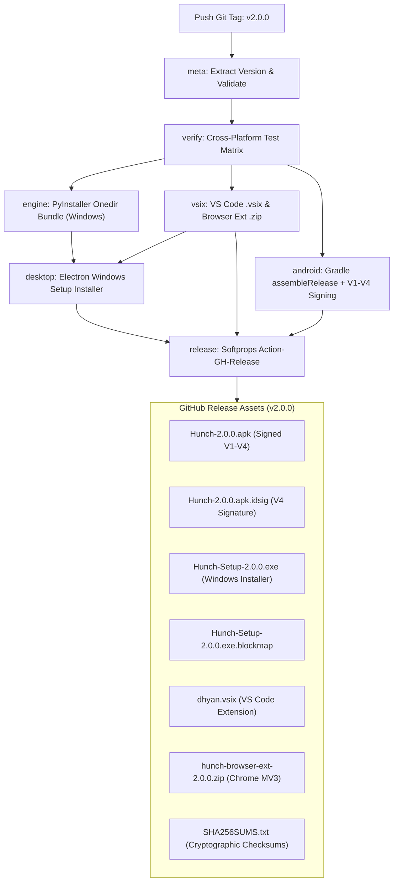

# Hunch Attention Twin — v2.0.0 Unified Versioning, OTA Update Checker & Release Packaging Specification

**Repository:** `https://github.com/abhigyan24-ops/hunch-attention-twin`  
**Target Version:** `v2.0.0` (Android `versionCode = 2`, `versionName = "2.0.0"`)  
**Scope:** `phone/`, `laptop/`, `engine/`, `vscode-ext/`, `browser-ext/`, `.github/workflows/release.yml`, `CHANGELOG.md`

---

## 1. Executive Summary & Release Intent
`v2.0.0` represents the first major production release of **Hunch** (formerly Dhyan). It introduces:
1. **The Hunch Rebrand & Complete Onboarding Trust Architecture:** Permanent signing keystore (`ANDROID_KEYSTORE_B64`), V1–V4 APK signing schemes, 4-tier progressive trust onboarding, and Android 13–15 Restricted Settings unlocker.
2. **On-Device Machine Learning & Contextual Bandit:** 12-dimensional online survival hazard model, 18-step rollout trajectory, 4-arm Diagonal LinUCB bandit, and federated model weight sync.
3. **Zero-Knowledge Uninstall Survival:** 3-layer `AES-256-GCM` + `PBKDF2` / Windows DPAPI vault (`.hunchvault` + scoped backup + 1-second desktop rehydration).
4. **Digital Wellbeing & Circadian Rhythms:** 7-day automatic bedtime inference, 30-minute wind-down audio fade, and sleep-adjusted focus block sizing (25m vs 50m).
5. **Dual-Use Study Mode & Flow Shields:** Chrome browser exemption, surgical YouTube Shorts vs. lecture classifier, cross-device code-along horizon ($t \le 180\text{s}$), 4-gate walk-away fusion, flip-to-focus desk gestures, call auto-pause, build shield, mental replay, and interactive break digest.

---

## 2. Unified v2.0.0 Semantic Versioning Contract

To prevent cross-device handshake mismatches and ensure sideloaded Android users can install `v2.0.0` directly over `v1.0.0` without losing application state or Room databases:

| Workspace | File Path | Version Field | Target Value | Notes |
| :--- | :--- | :--- | :--- | :--- |
| **Root** | `VERSION` | Plaintext SemVer string | `2.0.0` | Canonical version reference for CI scripts |
| **Android Companion** | `phone/app/build.gradle.kts` | `versionCode` / `versionName` | `versionCode = 2`<br>`versionName = "2.0.0"` | Incremented `versionCode` allows clean in-place APK updates |
| **Python Engine** | `engine/twin/api/app.py` | `ENGINE_VERSION`, `/v1/health` | `"2.0.0"` | Broadcast in health check, handshake, and telemetry frames |
| **Laptop App** | `laptop/package.json` | `"version"` | `"2.0.0"` | Electron packaged installer and auto-updater metadata |
| **VS Code Extension** | `vscode-ext/package.json` | `"version"` | `"2.0.0"` | Extension marketplace & packaged `.vsix` version |
| **Browser Extension** | `browser-ext/manifest.json` | `"version"` | `"2.0.0"` | Chrome MV3 extension sensor version |

---

## 3. Sideload-Friendly GitHub Release Update Checker

### 3.1 Architecture & Threat Model
Because sideloaded Android and Desktop installations do not receive automatic updates via Google Play or the Microsoft Store, Hunch incorporates an on-device GitHub Release Update Checker.
- **Zero Privacy Infiltration:** The client sends **no user telemetry, hardware IDs, or IP tokens** to the GitHub API. It requests only public release metadata.
- **Battery & Rate-Limit Shield:** Checks are throttled to a minimum **24-hour interval** (`86,400,000 ms`), persisted in local storage (`SharedPreferences` on Android, SQLite / in-memory on Desktop).
- **Graceful Offline Fallback:** Network failures, timeouts, and GitHub rate limits fail silently without blocking app launch or interrupting user flow.

### 3.2 GitHub Releases API Contract
- **Endpoint:** `GET https://api.github.com/repos/abhigyan24-ops/hunch-attention-twin/releases/latest`
- **Headers:**
  - `Accept: application/vnd.github+json`
  - `User-Agent: Hunch-Attention-Twin/2.0.0`
- **Sample Payload Structure:**
```json
{
  "tag_name": "v2.1.0",
  "html_url": "https://github.com/abhigyan24-ops/hunch-attention-twin/releases/tag/v2.1.0",
  "body": "### Hunch v2.1.0 Release Notes\n- Enhanced LinUCB exploration bonus...",
  "assets": [
    {
      "name": "Hunch-v2.1.0.apk",
      "browser_download_url": "https://github.com/abhigyan24-ops/hunch-attention-twin/releases/download/v2.1.0/Hunch-v2.1.0.apk"
    },
    {
      "name": "Hunch-Setup-2.1.0.exe",
      "browser_download_url": "https://github.com/abhigyan24-ops/hunch-attention-twin/releases/download/v2.1.0/Hunch-Setup-2.1.0.exe"
    }
  ]
}
```

### 3.3 Semantic Version Comparator (`SemVerComparator`)
Version tags are normalized by stripping leading `v`/`V` and parsing into `(major, minor, patch, isPreRelease)`:
1. **Numeric Hierarchy:** A version with a strictly greater `major`, `minor`, or `patch` is newer:
   $$\text{compare}((M_1, m_1, p_1), (M_2, m_2, p_2)) > 0$$
   - Example: `2.0.0 > 1.0.0`, `2.1.0 > 2.0.0`, `2.0.1 > 2.0.0`.
2. **Pre-Release Precedence:** When `(major, minor, patch)` are identical:
   - A stable release is strictly newer than a pre-release (`2.0.0 > 2.0.0-beta`).
   - Identical versions return `false` (`isRemoteVersionNewer("2.0.0", "v2.0.0") == false`).

### 3.4 Client Actions & UI Surfacing
- **Android Companion (`phone/`):**
  - When `updateAvailable == true`, the dashboard renders an actionable card:  
    *"Hunch v2.1.0 is available — Tap to download latest APK"*
  - Clicking launches `Intent(Intent.ACTION_VIEW, Uri.parse(apkDownloadUrl))` to begin direct in-browser download of the signed APK.
- **Laptop Application (`laptop/`):**
  - Renders a subtle update pill in the Insights header linking to the platform installer asset or release notes.

---

## 4. CI/CD Multi-Artifact Release Pipeline (`.github/workflows/release.yml`)

When tag `v2.0.0` (or `v*`) is pushed to `origin`:



### 4.1 Asset Integrity & Verification Guarantees
1. **Permanent Release Key:** Signed with `ANDROID_KEYSTORE_B64` certificate SHA-256:  
   `3ec8e983132712b44585e4986378a42beba71bfd48d4d20f3452d3b860d653d4`.
2. **Signature Schemes:** Fully verified across V1, V2, V3, and V4 via Android SDK `apksigner`.
3. **Reproducible Checksums:** `SHA256SUMS.txt` is computed in CI and attached to the release for tamper-proof distribution.
