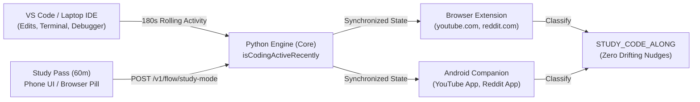

# Hunch Attention Twin — Dual-Use Study Mode, Surgical Shorts Filter & Code-Along Specification

**Repository:** `https://github.com/abhigyan24-ops/hunch-attention-twin`  
**Scope:** `phone/`, `browser-ext/`, `engine/`, `laptop/`, `vscode-ext/`  
**Status:** Approved Specification & Implementation Guide  

---

## 1. Executive Summary & Core Product Philosophy

Traditional focus blockers treat software categorically: they flag entire applications like **Google Chrome**, **YouTube**, or **Reddit** as pure distractions. For engineers, researchers, and students, this blunt heuristic actively destroys productivity:
- **Browsers Are Development Environments:** Browsers host local web applications (`localhost:3000`), official API documentations (MDN, Python, Rust, Android Docs), and technical Q&A (Stack Overflow, GitHub Issues).
- **YouTube Is a University:** University courses (MIT OCW, Stanford CS, CS50), system design deep-dives, and compiler tutorials live alongside entertainment feeds.
- **Reddit Hosts Specialized Engineering Communities:** Subreddits like `r/rust`, `r/machinelearning`, and `r/devops` are primary sources of technical solutions not indexed elsewhere.

Hunch adopts the **Dual-Use Study Principle**:
1. **Browsers Are Never Blocked:** Web browsers (`com.android.chrome`, `org.mozilla.firefox`, `com.brave.browser`, `com.microsoft.emmx`) are 100% exempt from mobile app blocking and reflex-unlock detection. Content evaluation occurs surgically within the browser extension rather than via OS-level process killing.
2. **Surgical Content & Behavior Classification:** Hunch differentiates between **Active Study / Code-Along** and **Dopamine Drift** using URL paths, document/media titles, touch cadence, and real-time cross-device IDE keystroke correlation.
3. **Ask Once, Never Force-Block Dual-Use Platforms:** For ambiguous long-form video consumption (8+ minutes of passive playback without coding activity or educational titles), Hunch renders a non-intrusive 2-button choice pill (*"Studying from this video?"* -> **[Yes, Studying (60m)]** | **[Park Video at Current Timestamp]**) instead of slamming the screen shut.

---

## 2. Three-Tier Application & Domain Taxonomy

| Tier | Category | Android Package IDs & Web Domains | Interception & Policy Rule |
| :--- | :--- | :--- | :--- |
| **Tier 1: Always-Allowed Research & Browsers** | Essential Tools & Research | **Android:** `com.android.chrome`, `org.mozilla.firefox`, `com.brave.browser`, `com.microsoft.emmx`<br>**Web:** `localhost`, `127.0.0.1`, `github.com`, `stackoverflow.com`, `developer.mozilla.org`, `docs.*`, `developer.*`, `arxiv.org`, `leetcode.com`, `codeforces.com`, `*.edu`, `*.ac.in` | **100% Exempt.** Never triggers Phantom Unlock or Doomscroll counters on Android. In-browser drift detection respects research tools. |
| **Tier 2: Dual-Use Study & Technical Media** | Context-Dependent Knowledge | **Android:** `com.google.android.youtube`, `com.reddit.frontpage`<br>**Web:** `youtube.com`, `reddit.com`, `medium.com`, `substack.com` | **Context-Evaluated.** Automatically allowed during Code-Along or Study Mode, or when titles/subreddits match educational taxonomy. Surgical 90s–240s interception on `/shorts/` and rapid-swipe mobile feeds. Ambiguous long-form triggers an 8-minute choice pill. |
| **Tier 3: Pure Social & Dopamine Feeds** | Infinite Feed Platforms | **Android:** `com.instagram.android`, `com.zhiliaoapp.musically` (TikTok), `com.snapchat.android`, `com.facebook.katana`, `com.twitter.android`<br>**Web:** `instagram.com`, `tiktok.com`, `x.com`, `twitter.com`, `facebook.com`, `netflix.com` | **Strict Shielding.** Enforces 4-minute gentle nudge and 8-minute firm breaker during Focus Shield, Peak Focus Windows, or past bedtime. |

---

## 3. Cross-Device "Code-Along" Telemetry Signal

Developers frequently follow video tutorials or build projects while watching conference presentations or coding tutorials.



### 3.1 Rolling Horizon Calculation
- **Producer (`vscode-ext/` & `laptop/`):** Posts editor interactions (text edits, symbol jumps, task completions, and build executions).
- **Engine Horizon (`engine/`):**
  $$\text{isCodingActiveRecently} = (\text{now\_ts} - \text{last\_code\_activity\_ts}) \le 180\text{ seconds}$$
- **Synchronized Study Pass:**
  $$\text{studyModeActive} = \text{now\_ts} < \text{study\_mode\_until\_ts}$$
- **Consumer Bypass:** If `isCodingActiveRecently == true` OR `studyModeActive == true`, dual-use media usage is classified as `STUDY_CODE_ALONG`, suppressing all drift notifications and keeping telemetry free from false distraction flags (`was_distracted = 0`).

---

## 4. Surgical YouTube & Reddit Classification Engine

### 4.1 Browser Extension (`browser-ext/`)
The browser extension inspects URL patterns, DOM video elements, and active window context:

1. **YouTube Shorts (`youtube.com/shorts/*`):**
   - Classified as `HIGH_DOPAMINE_SHORTS`.
   - In active focus or work sessions, an interception banner appears after **90 seconds**:  
     *"Shorts loop detected — Jump back to your task or switch to long-form search?"*
2. **Long-Form Video (`youtube.com/watch*` & `youtube.com/playlist*`):**
   - **Auto-Allow Condition 1 (Code-Along):** `isCodingActiveRecently == true`.
   - **Auto-Allow Condition 2 (Educational Title Taxonomy):** Video title or channel contains case-insensitive keywords:
     `lecture`, `tutorial`, `course`, `crash course`, `programming`, `algorithm`, `data structures`, `dsa`, `system design`, `distributed systems`, `operating systems`, `dbms`, `compiler`, `machine learning`, `deep learning`, `neural network`, `math`, `calculus`, `linear algebra`, `probability`, `physics`, `engineering`, `gate`, `nptel`, `mit`, `stanford`, `harvard`, `cs50`, `leetcode`, `codeforces`, `python`, `rust`, `typescript`, `javascript`, `react`, `nextjs`, `android`, `kotlin`, `java`, `c++`, `golang`, `docker`, `kubernetes`, `aws`, `linux`, `git`, `debugging`, `documentation`, `conference`, `keynote`.
   - **Ambiguous Fallback (8-Minute Choice Pill):** If neither Condition 1 nor Condition 2 matches after **480 seconds (8 minutes)** of continuous playback, inject a calm top choice pill:
     - **Button 1 — `[Yes, Studying (Allow 60m)]`:** Calls `POST /v1/flow/study-mode` and whitelists the tab for the session.
     - **Button 2 — `[Park Video at Current Time]`:** Reads `document.querySelector('video')?.currentTime`, passes `resumeTimestampSeconds` to `POST /v1/flow/park-tab`, and closes the tab.
3. **Reddit Subreddits:**
   - **Technical Subreddits:** `/r/(programming|rust|typescript|javascript|reactjs|node|python|learnpython|cpp|java|androiddev|kotlin|golang|devops|docker|kubernetes|linux|neovim|vim|vscode|cscareerquestions|experienceddevs|machinelearning|localllama|artificial|compsci|algorithms|leetcode|gate|engineeringstudents)` are classified as `PRODUCTIVE_STUDY`.
   - **Home Feeds & Entertainment Subreddits:** Classified as `PURE_SOCIAL_DRIFT` (4-minute standard drift threshold).

### 4.2 Android Companion Classifier (`phone/`)
On Android, `DoomscrollVelocityBreaker.kt` and `PhantomUnlockDetector.kt` evaluate mobile media consumption without intrusive screen recording:
1. **Browser Exemption:** `com.android.chrome`, `org.mozilla.firefox`, `com.brave.browser`, and `com.microsoft.emmx` are excluded from all doomscroll and phantom unlock filters.
2. **Dual-Use Evaluation (`evaluateForegroundSample`):**
   - **Signal 1:** `isLaptopCodingActive == true` or `isStudyPassActive(nowMillis) == true` -> returns `DoomscrollStage.STUDY_MODE_ACTIVE`.
   - **Signal 2:** `isEducationalTopic(mediaTitle) == true` -> returns `DoomscrollStage.STUDY_MODE_ACTIVE`.
   - **Signal 3:** `isPortraitRapidSwipe == true` (Shorts/Reels swipe signature) -> triggers gentle nudge at 4m and firm breaker at 8m in high-risk contexts.
   - **Signal 4:** Ambiguous passive viewing (landscape or stationary playback without title match or coding) -> at 8 minutes (480s), returns `DoomscrollStage.ASK_IF_STUDYING` prompting the user to enable a 60-minute Study Pass or park the video.

---

## 5. Engine API Contracts & SQLite Accounting

### 5.1 Study Mode Endpoints
- **`POST /v1/flow/study-mode`**
  ```json
  {
    "active": true,
    "durationMinutes": 60,
    "source": "user_ui",
    "topicTitle": "CS50 Lecture 4"
  }
  ```
  Response:
  ```json
  {
    "success": true,
    "studyModeActive": true,
    "remainingMinutes": 60,
    "topicTitle": "CS50 Lecture 4"
  }
  ```
- **`GET /v1/flow/study-mode`**
  Response:
  ```json
  {
    "studyModeActive": true,
    "remainingMinutes": 58,
    "isCodingActiveRecently": true,
    "activeTopic": "CS50 Lecture 4"
  }
  ```
- **`GET /v1/flow/active-context`**
  Returns unified synchronization context for desktop, mobile, and browser clients:
  ```json
  {
    "studyModeActive": true,
    "isCodingActiveRecently": true,
    "remainingStudyMinutes": 58,
    "activeTopic": "CS50 Lecture 4",
    "lastCodeActivityTs": 1731550000.0,
    "activeWorkspace": "hunch-attention-twin"
  }
  ```

### 5.2 Timestamped Video Parking
- **`POST /v1/flow/park-tab`** accepts `resumeTimestampSeconds: int | None`.
  - YouTube URLs are stored with `&t=${resumeTimestampSeconds}s` (or `?t=...`).
  - Stored tabs include `paused_badge` formatted as `"Paused at MM:SS"` (or `"Paused at H:MM:SS"`).

### 5.3 ML Model Integrity (`ml_model.py` & `real_activity_buckets`)
Whenever `studyModeActive == true` or `isCodingActiveRecently == true`:
- Activity bucket ingestion automatically sets `was_distracted = 0`.
- The Online Logistic Hazard ML model treats the session as legitimate deep work and does not penalize legitimate study sessions.
