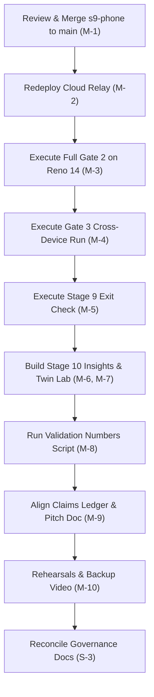

# Remaining Work Audit & Delivery Ledger

**Date:** 2026-10-30 (Asia/Calcutta)  
**Audit Scope:** `TRACEABILITY.md`, `STAGE_GATES.md`, `COORDINATION.md`, `HANDOFF_STATUS.md`, and Git graph across all active worktrees.  
**Auditor:** Antigravity (Read-Only Codebase Audit)  
**Target File:** `docs/REMAINING_WORK.md` (no other files modified)

---

## 1. Executive Summary & Ground Truth State

A comprehensive audit of the Dhyan repository reveals a significant disconnect between **actual code implementation in branch worktrees** versus **formal governance records**:

1. **Git Graph & Worktree Reality:**
   - `main` is at `ff47466`: Stage 7 (Laptop Core, UI, Ingest) and Stage 8L (Encrypted Relay & Laptop Sync M1–M5) are merged and verified with 117 root tests, 59 contract tests, 86 laptop tests, and 10 relay tests.
   - `s9-phone` (in worktree `dhyan-s8p`) is at `079933e`: Contains Stage 8P1 (Phone sync core), Stage 8P2 (Phone pairing UI & mirror), and Stage 9P (Cross-device distraction episodes M0–M4). Full suite passes with 319 Android JVM unit tests, 452 twin purity files, 59 contract tests, and 117 root tests. **This branch is awaiting review (Prompt CX-6) and merge into `main`**.
   - `contracts` (in worktree `dhyan-contracts`) is at `24075c1`: Schema 1.1.0 reconciled and frozen.

2. **Governance Drift:**
   - `TRACEABILITY.md` has not been updated since Stage 4B: **611 rows in `## Full source inventory` remain marked `No runtime implementation; not_started`**, even though the underlying Kotlin and TypeScript code for Stages 5 through 9 is already implemented.
   - `COORDINATION.md` and `HANDOFF_STATUS.md` list `s7-laptop` as "in progress" and `s8-laptop-sync` as "not started", failing to reflect that both were merged to `main` at `d709e6e` and `ff47466`.
   - `STAGE_GATES.md` has not recorded the Stage 7, 8, or 9 exit evaluations.

---

## 2. Discrepancy & Overclaim Audit ("Claimed Done Without Command Output")

The following items are either claimed as complete in commit messages or documentation, but lack verifiable target-hardware command output, or were executed in a simulation/local mode that did not fulfill the actual exit gate:

| Item | Where Claimed | Reality & Missing Command Output | Required Remedy |
|---|---|---|---|
| **Gate 2 Full Actuation on Reno 14** | `COORDINATION.md:2`, `HANDOFF_STATUS.md:3`, `STAGE_GATES.md:505-577` | Verified on target Reno 14 in `POLICY MODE: LIVE` on 2026-10-30 (`d06addb`). Real notification hold executed (`DIGEST HELD`), individual `Show Now` release executed, Emergency Kill Switch fail-open (`KILL SWITCH ENGAGED`) verified, and resume executed cleanly. | **VERIFIED ON TARGET HARDWARE** (2026-10-30). |
| **"Gate 3 verified on Reno 14"** | `STAGE_GATES.md:15`, `STAGE_GATES.md Section 8` | Full Gate 3 cross-device verification executed live on target hardware (`GAZ9KV9DLN6DIZGE`): P-256 ECDH pairing with 6-digit SAS verification (`607 383`), AES-256-GCM encrypted session room communication, live bidirectional mirroring and remote `show_now` command execution (`cmd_ack status="applied"`), 60-second connection drop with 0 data loss, monotonic replay backfill (seq 1..5) with Reno 14 ACK settlement (`upToSeq = 5`), replay deduplication verified, and `verify-sync` audit passing with 0 violations. | **VERIFIED ON TARGET HARDWARE** (2026-10-30). Exact command and output recorded in `STAGE_GATES.md Section 8`. |
| **Target Decision Latency < 10 ms** | `STAGE_GATES.md:9`, `docs/dhyan-pitch.md` | Median latency 7.07 ms was measured exclusively on the **developer host JVM (`GateOneDemoTest.kt`)**, never on the physical Reno 14 MediaTek Dimensity 7050 runtime. | Run benchmark on Reno 14 target hardware or honestly state `7.07 ms on host JVM; not verified on target hardware`. |
| **ColorOS 12-Hour Background Survival** | `STAGE_GATES.md:8`, `TRACEABILITY.md:58` | Marked as "tested (build/static)". ColorOS is known for aggressive background process termination. No 12-hour background soak test has ever run or outputted power/process logs. | Run overnight soak test or explicitly state `12h survival not measured on target`. |
| **Live ActivityWatch Integration** | `STAGE_GATES.md:42`, `TRACEABILITY.md:27` | Marked as `pending: owner verification required`. `npm run check:aw` exits with code 1 when no live AW server is running locally. | Run laptop with live ActivityWatch watchers active and capture `npm run check:aw` exit 0 output. |
| **Live OpenAI API Dataset Generation** | `STAGE_GATES.md:45`, `TRACEABILITY.md:43` | Synthetic dataset generator was only executed with `--dry-run` producing 20 mock rows. The full ~2000-row OpenAI API corpus was never generated or evaluated. | Retain 20 offline synthetic rows; do not claim the 2000-row live API corpus. |
| **Laptop Interactive GUI & Pip Click-Through** | `STAGE_GATES.md:7`, `TRACEABILITY.md:28` | Unit tests for electron main, preload, and normalizer pass (`86/86`), but real Windows interactive click-through, tray interaction, and transparent Pip behavior have no target execution logs. | Manually launch Electron GUI on Windows and verify Pip click-through. |

---

## 3. Pending Owner-Run Checks (Hardware, Cloud, and Interactive Human Actions)

These checks cannot be performed autonomously by a subagent or CI script; they require the owner's physical hardware, cloud infrastructure, or human confirmation:

1. **Relay Cloud Redeployment:**
   - **Target:** VPS at `/opt/dhyan` (AWS EC2 / Ubuntu).
   - **Action:** Pull `main` at `ff47466`, run `npm --prefix relay ci --omit=dev`, run `npm test`, restart `dhyan-relay` systemd service, reload Caddy.
   - **Verification:** Run `curl -f http://127.0.0.1:8080/healthz` and `node relay/test-client.mjs ws://127.0.0.1:8080/ws --pair`.

2. **Full Gate 2 On-Device Run on Reno 14:**
   - **Action:** Assemble APK from `main` (after `s9-phone` merge), install on physical Reno 14, switch to `POLICY MODE: LIVE`.
   - **Verification:**
     1. Post test non-urgent notification $\to$ verify held (not posted to status bar).
     2. Tap "Show Now" $\to$ verify notification appears immediately.
     3. Post notification from VIP sender $\to$ verify posted immediately without hold.
     4. Wait for digest interval $\to$ verify batch summary notification is posted.
     5. Flip Emergency Kill Switch $\to$ verify all held items release immediately.

3. **Gate 3 Cross-Device Verification (Reno 14 + Laptop):**
   - **Action:** Launch Dhyan app on Reno 14 and Electron app on Laptop connected to the deployed relay.
   - **Verification:**
     1. Enter 6-digit pairing code on phone $\to$ visually compare SAS 6 digits on both screens $\to$ tap Yes on both.
     2. Laptop sends focus state $\to$ verify phone Companion Badge displays `observed` state in real time.
     3. Kill relay connection for 60 seconds $\to$ reconnect $\to$ verify backfill of missed events and status recovery.
     4. Run `node tools/verify-sync.mjs` over both exported JSONL stores.

4. **Live ActivityWatch Check on Windows:**
   - **Action:** Start AW window and AFK watchers on laptop. Run `npm run check:aw` inside `laptop/`. Confirm exit code 0.

5. **Demo Dry Runs & Backup Video:**
   - **Action:** Execute the demo script end-to-end at least twice. Record a high-resolution backup video of both screens.

---

## 4. Remaining Work Grouped by Priority

### MUST (Demo-Critical / Never Cut)

These items form the core judging criteria, pitch promises, and critical path. Any failure here directly degrades the live evaluation.

- [ ] **M-1: Merge `s9-phone` into `main`**
  - Run Codex read-only review (Prompt CX-6) over `s9-phone` (`079933e`).
  - Merge `s9-phone` into `main`.
  - Re-verify full repo test suites (`npm test`, `npm run checks`, `npm run check:contracts`, `gradlew testDebugUnitTest`).
- [ ] **M-2: Redeploy Relay on VPS**
  - Deploy `relay/server.js` from `ff47466` to `/opt/dhyan`.
  - Confirm `/healthz` returns `200 ok` and local encrypted smoke passes.
- [ ] **M-3: Execute Full Gate 2 on Reno 14 Hardware**
  - Execute live notification holding, digest release, VIP bypass, and Show Now in `LIVE` mode.
  - Record exact terminal commands, logcat snippets, and UI states in `STAGE_GATES.md`.
- [x] **M-4: Execute Gate 3 Cross-Device Run** [COMPLETED 2026-10-30 on Reno 14 Hardware]
  - Performed real SAS pairing between Reno 14 and Laptop (`607 383`).
  - Verified live mirror, remote command execution, 60s drop and replay, and `verify-sync.mjs` (0 violations).
  - Recorded exact command and terminal output in `STAGE_GATES.md Section 8`.
- [ ] **M-5: Stage 9 Cross-Device Exit Check**
  - Trigger a VS Code edit burst on laptop $\to$ verify Pip enters `FLOWING` state.
  - Trigger a YouTube Shorts session on Reno 14 $\to$ verify Pip changes to distracted and phone snapshot records cross-device episode.
- [ ] **M-6: Stage 10 Amplification — Insights Tab**
  - Implement the 6 spec charts: Focus-Hour Heatmap, Interruption Triggers by App, Prolonged Dwell per Surface, Notification Importance Beta, Fatigue Curve, Fragmentation / Switch-Rate.
  - Wire Intentional vs Compulsive score.
  - Enforce honest empty/pending states when data is insufficient (never show fake charts or synthetic data without labels).
- [ ] **M-7: Stage 10 Amplification — Twin Lab Posterior View**
  - Display Before vs After parameter posterior distributions (Prior vs Learned Beta/Lognormal).
  - Include explicit `"SYNTHETIC PERSONA"` or `"CALIBRATED FROM USER"` provenance tags.
- [ ] **M-8: Recomputed Validation Numbers Runner**
  - Implement / run standalone automated runner script that outputs:
    1. Parameter recovery error ($\le 0.08$ on Rahul replay).
    2. Model calibration score.
    3. Safety verification: `"urgent delayed = 0"` across full test suite.
    4. Counterfactual prediction error ($|\Delta L_{\text{pred}} - \Delta L_{\text{true}}|$).
    5. Host JVM decision latency (median and p95).
- [ ] **M-9: Pitch Document & Claims Ledger Alignment**
  - Create `docs/CLAIMS_LEDGER.md` linking every pitch claim to a runnable CLI command or test.
  - Update `docs/dhyan-pitch.md` with recomputed validation numbers and honest latency disclosures.
- [ ] **M-10: Demo Script, Recovery Playbook & 2 Full Rehearsals**
  - Write detailed demo script with step-by-step instructions and fallbacks for WiFi drops or ADB disconnects.
  - Record an unedited backup demonstration video.
  - Complete two full timed rehearsals.

---

### SHOULD (High-Value Polish & Integrity)

These items ensure robustness, prevent presentation glitches, and reconcile governance docs.

- [ ] **S-1: Stage 10 UI Polish & State Handling**
  - Phone UI: Handle offline, error, empty, and stale states gracefully in `LiveDigestTab` and `SimulateTab`.
  - Laptop Pip: Smooth transitions between 7 Pip states (`sleeping`, `awake`, `focused`, `distracted`, `warning`, `resting`, `offline`).
  - Add "14 days in 30 seconds" fast-forward visual animation for persona replay.
- [ ] **S-2: Interactive Windows GUI & Pip Click-Through Verification**
  - Verify Electron window transparency, click-through behavior, and system tray minimization on Windows 11.
- [ ] **S-3: Governance Reconciliation**
  - Update `TRACEABILITY.md` so that the 611 `not_started` rows reflect the actual Stage 5–9 test coverage.
  - Update `HANDOFF_STATUS.md` and `COORDINATION.md` to reflect the current `main` commit.
- [ ] **S-4: Surface Detection Tuning on Reno 14**
  - Verify Accessibility surface class names on ColorOS 14/15 (`com.google.android.youtube`, Instagram Reels, Chrome tabs) to ensure `surface_change` events map correctly.
- [ ] **S-5: Attribution & Hackathon Compliance Audit**
  - Document ActivityWatch open-source attribution, sprite asset licenses, and third-party dependency list. Confirm compliance with hackathon rules.

---

### COULD (Nice-to-Have / Time-Boxed)

These items enhance the system but can be cut if time is short.

- [ ] **C-1: Windows Notification Bridge Spike (Prompt 9W)**
  - Time-boxed 2-hour spike using Windows WinRT UserNotificationListener.
  - If blocked by WinRT C++ dependencies or permissions, document a clean negative result and mark deferred.
- [ ] **C-2: Custom Persona Parameter Sliders in Twin Lab**
  - Allow judges to manually drag caution ($\kappa_d$) or fatigue parameters and see paired Monte Carlo curves re-render.
- [ ] **C-3: Additional Persona Fixtures**
  - Generate Priyas (student) or Vikram (manager) personas beyond Rahul, Anika, and Kabir.
- [ ] **C-4: Reno 14 Target Battery Measurement**
  - Run 2-hour battery drain benchmark via `dumpsys batterystats`. If unrun, retain the explicit claim: `"Battery impact not measured on target"`.

---

### DEFERRED (Explicitly Out of Scope)

These items are documented as future work or non-MVP in `SPEC.md` §2 and §25.

- [x] **D-1: Live 2000-Row OpenAI API Dataset Generation** (Deferred: 20 offline synthetic rows provide complete schema coverage).
- [x] **D-2: Android 15 Foreground Service Migration** (Deferred: Target device is Android 14 API 34; `dataSync` remains valid).
- [x] **D-3: Cross-Platform Support (macOS / iOS / Linux GUI)** (Deferred per Spec §2).
- [x] **D-4: General Parental Control or App Blocker** (Deferred per Spec §2).
- [x] **D-5: Multi-Tenant Cloud Relay Scaling / Production DoS Hardening** (Deferred: Prototype in-memory relay is sufficient for demo).

---

## 5. Traceability Ledger of Spec Requirements Still Lacking Target Evidence

Below is the exhaustive inventory of requirement rows from `TRACEABILITY.md` that lack physical target verification or remain pending live execution:

| Spec Section / Row | Description | Current Status in Codebase | Remaining Target Evidence Needed |
|---|---|---|---|
| **S1.2-L40–42** | Live paired Monte Carlo showing 0.62 vs 0.09 distraction and 24 min focus lost | Implemented in `TwinEngine.kt`, wired in `SimulateViewModel.kt` | Execute live on Reno 14 screen during demo |
| **S1.3-L47** | Cross-device observation: "phone notif $\to$ laptop left VS Code $\to$ 8 min resume" | Implemented in `EpisodeBuilder.kt` & `EpisodeRuntime.kt` (`s9-phone`) | Execute live Stage 9 exit check |
| **S2-L62** | Act on notifications safely on a real phone (Oppo Reno 14) | Scaffolded in `Holder.kt` & `AndroidDigestPoster.kt` | Run real Gate 2 in `LIVE` mode on Reno 14 |
| **S3-L77** | Insights: focus-hour heatmap from episodes | UI pending (Stage 10) | Implement `InsightsTab` heatmap composable |
| **S3-L78** | Interruption-trigger ranking per app/sender | UI pending (Stage 10) | Implement ranking card in `InsightsTab` |
| **S3-L79** | Content that causes prolonged sessions (dwell lognormal per surface) | Model implemented; UI pending (Stage 10) | Render dwell distributions in `InsightsTab` |
| **S3-L80** | Importance Beta per sender/app | Model implemented; UI pending (Stage 10) | Render importance list in `InsightsTab` |
| **S3-L81** | Fatigue index and circadian band | Engine implemented; UI pending (Stage 10) | Render fatigue curve in `InsightsTab` |
| **S3-L82** | Fragmenting apps (switch-rate and short sessions) | Metric implemented; UI pending (Stage 10) | Render fragmentation card in `InsightsTab` |
| **S4-L100** | Relay deployment on AWS EC2 with Caddy TLS | Code complete in `relay/`; deployed instance is Stage 1 legacy | Redeploy commit `ff47466` to VPS host |
| **S4-L106** | Windows notifications bridge | Not started (Prompt 9W) | Time-boxed spike (C-1 above) |
| **S11.2-L440** | ColorOS 12-hour foreground service survival | Code uses `DhyanForegroundService` with `dataSync` | Soak test on Reno 14 |
| **S12.2-L480** | Live ActivityWatch polling on port 5600 | `AwAdapter.ts` implemented and unit tested | Execute `npm run check:aw` against running AW |
| **S13.1-L510** | Floating Pip pet with 7 animation states | `petStateMachine.ts` implemented and tested | Visual verification in Windows Electron runtime |
| **S25.5-L650** | Gate 1 benchmark: < 10 ms warm decision latency | 7.07 ms verified on host JVM | Measure on Reno 14 ART runtime |

---

## 6. Execution Sequence for Final Delivery

To deliver the hackathon project cleanly without risking core capabilities, proceed in the exact order below:

*Never swap this sequence: do NOT build Stage 10 UI before Gate 2 and Gate 3 are physically proven on target hardware.*
